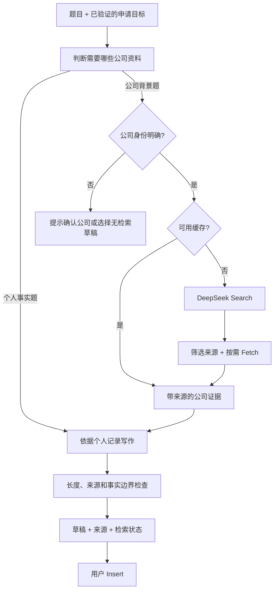

# Write with AI 搜索与 Agent 架构调查

调查日期：2026-10-26。根据当前仓库、已安装 SDK 源码、Context7 和官方文档整理。Context7 使用 `/websites/api-docs_deepseek`、`/vercel/ai/ai_7.0.0`、`/mastra-ai/mastra`；DeepSeek 的 Context7 查询未覆盖新 Search/Fetch 接口，相关结论以直接读取的官方接口文档为准。

本次仅增加调查文档，没有安装依赖、修改应用实现、调用付费 API、运行 build 或部署。下文区分已核实能力与建议设计；时限、缓存 TTL、调用预算都是待评估的初始配置。

## 建议结论

先采用 **DeepSeek Search/Fetch + 现有 AI SDK 7 + 显式写作 pipeline**。第一期在 Write with AI 前加入有来源的公司资料；需要后台运行和断线恢复时，复用已有 Cloudflare Workflows。Mastra 适合在新流程中逐步引入，不必先迁移整个 AI 层。

需要分清四层：Search/Fetch 提供外部信息，AI SDK 或 Mastra Agent 负责推理，pipeline/workflow 决定步骤和失败策略，Cloudflare 等执行环境负责持久执行。更好的错误处理主要来自后三层之间的明确契约。

| 选择 | 适用情况 | 当前建议 |
| --- | --- | --- |
| AI SDK + 小型同步 pipeline | 少量检索后生成一个答案 | 第一期默认，直接改善 Write with AI |
| AI SDK + Cloudflare Workflows | 多轮研究、后台任务、断线恢复、分步重试 | 第二期优先，项目已有可参考实现 |
| Mastra Agent + Cloudflare Workflows | 多个流程需要共享 agent/tool 配置和受限工具循环 | 选一条流程试点，Cloudflare 独占持久执行 |
| Mastra Workflows + 明确的执行 runtime | 分支图、暂停恢复和 Studio 已成为主要开发需求 | 有条件采用，单独评估 storage、权限和迁移 |

## 当前实现与具体缺口

实际入口是扩展在招聘表单下显示的 **Write with AI**，不是编辑器里的简历聊天。链路如下：

```text
overlay → background draft → POST /api/v1/autofill/generate
        → AutofillService.generate → AutofillModels.generate
        → AI SDK generateText → 草稿弹窗 → 用户 Insert
```

| 位置 | 已存在的能力 | 对本次设计的影响 |
| --- | --- | --- |
| [overlay.ts](../../../apps/extension/src/autofill/overlay.ts) | 先预览草稿，Insert 才写入；等待兜底 45 秒 | 继续由用户确认插入，来源放在草稿旁边 |
| [controller.ts](../../../apps/extension/src/background/autofill/controller.ts) | 调用 `api.autofill.generate`，客户端超时 35 秒 | 搜索或异步状态必须传到扩展，不能只改 prompt |
| [AutofillService.generate](../../../packages/resume-core/src/services/autofill-service.ts) | 字段范围检查、配额、run 计量、总计 30 秒 deadline、空输出的有限重试、长度处理 | 保留这些业务约束，补充阶段化结果和检索预算 |
| [context.ts](../../../packages/autofill/src/context.ts) | `applicantContext` 只有 Profile、resume、Notes 和日期 | 当前 writer 没有独立的目标公司或岗位上下文 |
| [autofill/text.ts](../../../packages/agent/src/autofill/text.ts) | 单次 `generateText`，`models.fast`，`maxRetries: 1` | 当前没有搜索工具或证据输入 |
| [GENERATE_PROMPT](../../../packages/agent/src/prompts/autofill.ts) | 仅根据个人记录写作，不从过去雇主推断申请公司 | 新增公司证据需要同时修改提示词与模型输入契约 |
| [autofill.ts](../../../packages/resume-core/src/domain/autofill.ts) | `GenerateResult` 只有 `text`、`quota` | 目前无法表示来源、检索降级或公司不明确 |
| [tailoring/workflow.ts](../../../apps/web/src/server/tailoring/workflow.ts) | Cloudflare 分步执行、重试、超时 | 复杂任务的持久执行已有项目内样板 |

`contextInput` 明确不读取 imported job context，[现有测试](../../../packages/resume-core/test/autofill-generate.test.ts)也验证 `useJob: true` 时仍不把 job/page 放进个人上下文。这是当前边界，不能为了搜索把整份招聘页面混入 `applicantContext`。建议仅给生成草稿这条路径新增 `applicationTarget` 和 `companyEvidence`，保持个人事实与公司资料分开。

错误也已有基础：[AutofillModelError](../../../packages/resume-core/src/ports/autofill-models.ts)保存 usage、是否可重试和结束原因；但 service 最终主要只留下 `timeout`/`model`，失败通常成为 `INTERNAL`，扩展再显示统一失败文案。应保留安全的错误类别贯穿各层，供用户采取不同操作。

编辑器聊天的 [turn.ts](../../../packages/agent/src/turn.ts) 已有工具循环、最多六步和停止条件，[run-lifecycle.ts](../../../apps/web/src/server/chat/run-lifecycle.ts)处理暂停、取消、失败和完成。因此这次不是从零搭建 agent，而是为写作功能增加研究流程，并逐步统一执行规范。

## DeepSeek Search API 核实

DeepSeek 在 **2026-10-17** 公布开放自研搜索 API。目前有两个可独立调用的 HTTP 接口，与生成模型解耦。[官方更新](https://api-docs.deepseek.com/updates/)

| 接口 | 请求 | 主要返回 |
| --- | --- | --- |
| `POST https://api.deepseek.com/v1/tools/search` | `query`、`count`、`need_content`，可选 `ori_question` | `results[]`，包含 URL、标题、摘要、正文和排序信息 |
| `POST https://api.deepseek.com/v1/tools/fetch` | `url` | `title`、Markdown `content` |

Search 的 `query` 限 1 至 128 个 Unicode 字符，`count` 为 1 至 50；`ori_question` 也限 128 字符。支持 `site:` 等检索运算符。`need_content: true` 时正文仍可能为空，不能把成功搜索等同于取得了全文。[Search API](https://api-docs.deepseek.com/api/search/)

Fetch 接受带 host 的 HTTP/HTTPS URL，长度最多 8192 字符，禁止用户名和密码；返回 schema 本身没有来源 URL，应由 adapter 保留请求 URL 作为来源标识。[Fetch API](https://api-docs.deepseek.com/api/fetch/)

两个接口使用现有 DeepSeek Bearer API key。服务端封装 HTTP adapter 即可，不需要为了搜索更换生成模型。示例请求体使用虚构公司，仅展示结构：

```json
{
  "query": "ExampleCo site:example.com engineering products",
  "count": 5,
  "need_content": true
}
```

实现时用 Zod 校验返回体，传入 AbortSignal，限制正文大小和来源数。搜索 key 只从 Worker 的 server env 读取，延续 [ai.ts](../../../apps/web/src/server/ai.ts) 的秘密配置方式。不要假设现有 `AI_BASE_URL` 指向的模型代理也实现了 Search/Fetch，搜索 base URL 单独配置，默认官方地址。

还有另一条路线：DeepSeek Responses API 的内置 `web_search` 由服务端执行，目前仅 `deepseek-v4-pro` 支持，`deepseek-flash` 会忽略；`max_tool_calls` 也被忽略，且没有 `previous_response_id` 持久会话。它不适合作为第一期精确控制搜索量和复用缓存的默认接法。[Responses API](https://api-docs.deepseek.com/guides/responses_api/)

已安装的 `@ai-sdk/deepseek` provider 暴露 chat 模型与 files 接口，未暴露这些独立 Search/Fetch 方法。建议直接增加 adapter，不假设 `deepseek.tools.webSearch()` 存在。依据是本地 `packages/agent/node_modules/@ai-sdk/deepseek/src/deepseek-provider.ts`，与仓库声明版本 `^3.0.39` 配套。

当前官方 Search 和 Fetch 单价均为 **每 1,000 次成功且有内容的请求 0.75 美元**；返回多少条结果不改变单次价格。Search、Fetch 账户限额分别为 100 QPS、25 QPS，Fetch 还受目标域名限流约束。官方另有工具内置调用的阶段性免费说明，项目按公布单价预算。[计费与限制](https://api-docs.deepseek.com/guides/search/#billing)

据此计算，若一份草稿用两次 Search 和两次 Fetch，搜索部分为 `4 × $0.00075 = $0.003`，1,000 份约 3 美元。这只是调用预算示例，不含模型 token、额外成功重试、缓存和基础设施费用，也不代表已实测总成本。

顺便发现：[models.ts](../../../packages/agent/src/models.ts) 和 Worker 配置仍使用 `deepseek-v4-flash`。官方说明旧名目前路由到新的 Flash，推荐名称是 `deepseek-flash`。实施时应明确使用别名还是固定模型策略；本次未改配置。[官方模型调用说明](https://api-docs.deepseek.com/)

## 建议的公司研究与写作流程



### 按题目决定搜索范围

| 题目 | 建议策略 |
| --- | --- |
| Why this company? | 产品、客户、使命，优先官网 |
| Which company value resonates with you? | 官网 values/careers 页面，连接真实个人经历 |
| What interests you about this role? | 经明确允许的岗位信息、相关产品和工程内容 |
| Tell us about a difficult project. | 只用个人记录，通常跳过公司检索 |
| 签名、工作许可、薪资、身份信息 | 沿用现有字段限制和 Profile 规则 |

第一期可以用题目规则与固定检索模板覆盖主要场景，复杂或模糊题目才调用一个小型规划步骤。模型可提议 topic/query，但公司身份、域名范围、调用数、长度和时间预算由代码验证。

公司身份来自当前申请的可验证信息和题目中的明确名称。`page.companyWeak`、URL slug、简历中上一家雇主都不足以单独确定目标。页面公司与题目公司冲突时停止自动猜测。后端同时验证 application、resume 和 posting 的归属关系，不能只相信前端发来的公司字段。

检索请求只含公司、公开域名、岗位类别和公开主题，不含姓名、邮箱、简历正文或 Notes。`ori_question` 仅在题目适合公开发送且经过长度与内容检查时提供；不能直接复制含个人信息的指令。

### 先取得证据，再生成答案

建议初始上限：一到两条 Search query，每条五个结果，选择两到三个来源，最多补抓两页。优先复用 Search 已返回的正文；只有重要来源缺正文时 Fetch。限制是产品预算，不是供应商要求，待测量后调整。

来源优先级：已核实的公司官网、官方 careers、官方产品/工程文档，再考虑明确可归属的第三方资料。`authority` 和 `rerank_score` 可辅助排序，但不能证明页面属于该公司，也不能当作事实准确率。

公司证据独立建模，至少包含：

- `sourceId`、`url`、`title`、`retrievedAt`、可空的 `publishedAt`。
- `companyIdentity`、`topic`、短事实与对应的正文片段。
- 来源是正文还是供应商摘要，以及可用性状态。

时间敏感信息必须带日期；没有可靠支持时不写“最新融资”“当前 CEO”等断言。搜索摘要可帮助选页，关键事实优先由正文支持。网页文本作为不可信资料处理，不能改变系统指令、扩大工具权限或要求发送个人记录。

writer 同时接收两类明确分开的输入：个人记录说明“申请者做过什么”，公司证据说明“目标公司做什么”。两者可用于论述匹配，但公司技术栈不能变成申请者拥有的经验，也不能虚构使用产品、长期关注公司等个人经历。

模型内部输出可改成简单结构化对象，包含草稿与使用的 `sourceId`；最终插入表单的仍是纯文本。代码检查 sourceId 来自本次结果、引用片段存在、长度符合字段要求。片段匹配不证明语义完全成立，仍需内容评估；可选一次受限修订，不引入无限 reviewer 循环。

来源和警告展示在草稿旁边，不自动塞进招聘表单。保留用户点击 Insert 的现有行为。公司资料也不自动进入个人 Notes 或简历。

### 缓存与返回契约

第一期可用用户范围的短期缓存，key 包含公司稳定身份/域名、topic、语言和查询策略版本。静态公司背景可先试 24 小时 TTL，近期动态用更短 TTL；这些数值需通过实际更新频率调整。缓存只存公开证据，不包含草稿或个人输入。

跨用户共享缓存作为后续独立优化，需先确保没有混入用户指令。不能仅按公司显示名缓存，以免同名公司混用；再生成草稿可复用资料，但不能忽略已有过期时间。

同步扩展 [GenerateResultSchema](../../../packages/resume-core/src/domain/autofill.ts)、[oRPC contract](../../../packages/api/src/contract/index.ts)、[extension protocol](../../../apps/extension/src/lib/autofill-protocol.ts) 和弹窗，传递 `sources` 与 `research.status`，例如 `used`、`skipped`、`unavailable`。公司不明确等需要用户输入的情况应有显式结果类型，不能用空字符串伪装成功。现有扩展需要兼容升级，可先增加可选字段，新增交互另设版本化契约。

## 错误处理与运行预算

建议内部错误结构至少包含 `stage`、`code`、`retryable`、`attempt`、`retryAfterMs` 和 `runId`。这些是建议新增的业务字段，不是现有 SDK 自动提供的统一协议。对外只发可操作的安全状态，供应商原始响应和异常消息留在边界内，不进入日志或 UI。

| 情况 | 内部策略 | 用户侧行为 |
| --- | --- | --- |
| Search 无结果 | 正常空结果，不按网络错误反复重试 | 说明未找到资料，允许无检索草稿 |
| 部分 Fetch 403/404 | 跳过该来源，保留其他结果 | 有足够证据就继续 |
| 408、429、5xx 或暂时网络故障 | deadline 内有限重试，遵守 Retry-After | 失败后显示资料暂不可用 |
| Provider 401/402 | 不自动重试，标记配置/余额问题 | 明确服务暂不可用，不要求用户重新登录 |
| 非法参数或不兼容返回 schema | 不盲重试，归类契约/配置问题 | 给安全失败状态，保留诊断元数据 |
| 公司不明确或来源冲突 | 需要用户补充或选择其他模式 | 确认公司，不生成具体公司事实 |
| 模型空输出或无效结构 | 在剩余预算内至多一次修复/重试 | 仍失败则保留旧草稿并允许重试 |
| 用户取消、操作过期 | 中止后续调用，拒绝迟到结果 | 保留当前输入，不自动重启 |
| 写作完成但保存结果失败 | 已有 artifact 时只重试保存 | 恢复原结果，避免重新生成 |

DeepSeek 对 Search/Fetch 的 HTTP 重试建议是 408、429、5xx 可重试，402 需先处理余额，其他 4xx 需先改变请求；上表其余行为是本项目的建议策略。[官方错误说明](https://api-docs.deepseek.com/guides/search/#errors)

检索失败不一定使写作失败，但只有剩余个人信息足够且模型服务可用时才能降级。同一 DeepSeek 账户余额耗尽时，不能承诺搜索失败后生成仍会成功。Provider 限流也不能被扩展误判为用户的产品小时配额已用完。

### 一层重试所有者与一个总 deadline

第一期继续使用 30 秒服务端总 deadline。例如先给授权/读取预留 2 秒，研究最多 7 秒，写作最多 18 秒，校验与收尾预留 3 秒。每一步都取剩余时间上限；这是调参起点，不是延迟承诺。35 秒扩展请求超时和 45 秒弹窗兜底要保持一致。若代表性题目持续无法在预算内完成，进入异步方案。

AI SDK 的 `maxRetries` 主要负责可重试的模型 API 调用，不能代替整个搜索写作流程的恢复。已安装源码中 retry 包裹模型调用，按可重试标记和响应头决定重试；工具执行错误还有独立结果路径。[AI SDK generateText](https://ai-sdk.dev/docs/reference/ai-sdk-core/generate-text)、[AI SDK 7 工具错误](https://github.com/vercel/ai/blob/ai%407.0.0/content/docs/03-ai-sdk-core/15-tools-and-tool-calling.mdx)

当前模型 adapter 的一次 SDK 重试与 service 的空输出重试有不同目的。新增执行层后应明确每种重试的归属和共享预算。同步 pipeline 可以由 adapter 处理短暂 HTTP 故障，service 只做受限输出修复；异步 workflow 掌管主要重试时，内层关闭或缩小自动重试。浏览器网络重发应使用同一幂等键。

供应商完成请求后客户端丢失响应，仍可能发生实际费用。记录请求次数、成功次数、已知 usage 和未知结果，不把未拿到 usage 当成零成本。现有 run 只累计模型 token，需另外记录 Search/Fetch 调用量及阶段耗时。

### 异步阶段的恢复设计

新增写作 operation，借鉴 tailoring 的业务模式，但使用独立类型和状态，不把草稿硬塞进简历定制表：

```text
queued → researching → drafting → validating → completed
       → needs_input / failed / cancelled / expired
```

启动端点短请求返回 operation ID，查询端点返回状态、阶段与安全错误；显式 Retry 和 Cancel 走同一鉴权边界。轮询先于复杂 SSE，扩展重启后可按 ID 恢复。

幂等键绑定用户、application、字段、个人资料快照版本、指令和策略版本。同一次网络重发复用 operation；用户主动 Regenerate 使用新 intent ID。任务关联不可变输入版本，旧请求晚到时不能覆盖用户已修改的草稿。

搜索证据、生成结果、最终提交分阶段保存。检查点尽量只返回 ID；业务内容继续通过现有 Supabase services 和 RLS 读写。成功结果已持久化后，后续重试直接使用该 artifact。外部生成响应丢失时仍可能重复调用，不能宣称恰好一次。

当前草稿不持久化。要支持跨连接恢复，需有意新增短期草稿存储、访问控制、过期删除和取消后的处理规则，而不是把草稿无期限存进 agent memory。业务存储与 logs/traces 是不同边界。

现有 tailoring 使用加密的短期用户凭证，每步重新鉴权。长时间 suspend 不能假设原 JWT 一直有效；到期后需使用新登录凭证恢复任务，或另行设计受限后台授权。不能为便利引入绕过 RLS 的 service-role 访问。

## Mastra 调查

### 与当前仓库的关系

当前 `packages/agent/package.json` 和 `apps/web/package.json` 使用 `ai ^7.0.89`，DeepSeek provider 为 `@ai-sdk/deepseek ^3.0.39`，前端为 `@ai-sdk/react ^4.0.92`。这次评估应以 AI SDK 7 为基线。

Mastra 官方已宣布兼容 AI SDK 7 的 `LanguageModelV4`，同时提供 `@mastra/ai-sdk` 的前端 stream 转换适配。可以保留现有 DeepSeek provider 和 `models.ts` 接口，由适配层接入 Mastra；不需要把全部模型配置搬到字符串形式的 model router。迁移时仍须检查具体稳定包版本和流式事件契约。[AI SDK v7 support](https://mastra.ai/blog/ai-sdk-v7-support)

仓库已经有持久工作流：[`wrangler.jsonc`](../../../apps/web/wrangler.jsonc) 注册 `TAILOR_WORKFLOW`；[`tailoring/workflow.ts`](../../../apps/web/src/server/tailoring/workflow.ts) 调用 Cloudflare `step.do`，配置每步重试与超时；[`tailoring/runner.ts`](../../../apps/web/src/server/tailoring/runner.ts) 将工作拆成 `claim → parse → generate → commit`。步骤只返回操作 ID，内容经现有 service 和用户权限存储。这是可复用的基础，不需要先引入框架才能实现多步执行。

### 哪些能力有帮助

| 需求 | Mastra 已提供的能力 | 本项目中的用法 |
| --- | --- | --- |
| 固定顺序的研究与写作 | `createStep`、`createWorkflow`、步骤输入输出 schema | 明确拆开检索、证据提取、写作、校验 |
| 多源研究 | `.parallel()`、`.foreach()` 和并发限制 | 并行读取少量已选来源，限制外部调用量 |
| 按题目分支 | `.branch()` | 公司动机题检索公司，个人事实题跳过检索 |
| 工具由模型选择 | `Agent` 的工具循环和停止条件 | 只在检索问题复杂且需要自主补查时使用 |
| 用户补充信息 | `suspend()`、`resume()`、持久 snapshot | 公司身份无法确认时等待选择，随后恢复 |
| 可视化调试 | Studio 的工作流图和分步结果 | 开发期检查路径和失败步骤 |

上述区别来自 [Agents](https://mastra.ai/docs/agents/overview)、[Workflows](https://mastra.ai/docs/workflows/overview)、[Control flow](https://mastra.ai/docs/workflows/control-flow)、[Suspend and resume](https://mastra.ai/docs/workflows/suspend-and-resume) 和 [Studio](https://mastra.ai/docs/studio/overview)。

设计建议：公司背景写作适合由固定 workflow 控制顺序，内部按需调用一个受限 researcher 和一个 writer。它不要求先搭 supervisor 加多个自主子 agent。等确有动态分工、反复补查、多轮审核时再增加自主性。

### 错误处理能改善什么

Mastra workflow 结果携带 `status` 和逐步结果；支持 workflow `retryConfig` 与 step `retries`，也能把已处理的失败转成输出，显式走降级分支。`onFinish`、`onError` 是生命周期回调，官方明确它们不具备持久执行或自动重试保证，因此关键提交不能只放在回调里。[Workflow error handling](https://mastra.ai/docs/workflows/error-handling)

Agent 调用支持时间预算 `timeout.totalMs`、`stepMs` 和流式首块 `firstChunkMs`。总预算到期会结束整个 run；单模型超时和 fallback 的行为不同，应单独配置。它还提供模型调用的 `maxRetries`，这些配置不代替业务层的错误分类。[Agent.generate reference](https://mastra.ai/reference/agents/generate)

本项目仍须自己定义以下策略，换框架不会自动获得正确行为：

- Provider 429、暂时性网络失败、5xx 允许有限重试；provider 401、402 和无效参数直接停止。Provider 密钥失败不等于用户登录过期，provider 限流也不等于用户已用完产品配额。
- 找不到可信来源作为正常结果返回，允许只根据已知信息写作，并向用户说明没有使用已核实的公司资料。
- 一个来源抓取失败时保留其他来源，不让整个写作任务失败。
- 校验失败可以限次数修复；不得通过无限重试把总时延和费用放大。
- 用户取消、操作过期、简历变更和重复提交分别处理。
- 写作成功、结果持久化失败时仅重试提交，不重新生成。
- 统一 operation ID、stage、attempt、deadline、可重试错误码，日志只记录这些元数据。

每个外部调用只选一层负责主要重试。在 Cloudflare Workflow 管理步骤时，减少或关闭内层 Mastra 与模型 SDK 的自动重试，并把剩余预算传入每次搜索和生成调用。不能让 Cloudflare、Mastra step、模型 SDK、前端分别独立重试同一次操作。

### 持久执行与 Cloudflare 部署

Mastra 有官方 `CloudflareDeployer`，能生成独立 Mastra Worker 的部署产物。官方也明确，使用已有 Web 框架或 server adapter 时，应继续沿用该框架的部署方法。对本仓库，先在已有 TanStack Start Worker 内以库的形式接入；无需替换 `vite.config.ts` 或现有 HTTP 入口。Worker 本地文件不适合持久存储。[Cloudflare deployment](https://mastra.ai/integrations/deploy/cloudflare)、[CloudflareDeployer](https://mastra.ai/reference/deployer/cloudflare)

官方安装文档提供 Bun 用法。调查时 `main` 分支的 core package 是 alpha 版本，其 `engines.node` 为 `>=22.13.0`；这是开发工具链核查点，不能据此把 alpha 当成推荐生产版本，也不能把 Node 要求直接等同于 Worker 运行时要求。实施时选择并锁定稳定版本，再核对实际导出、Node 依赖、Worker 打包体积和运行行为。[Manual install](https://mastra.ai/reference/manual-install)、[core package source](https://github.com/mastra-ai/mastra/blob/main/packages/core/package.json)

Mastra 普通 workflow 有 snapshot 和恢复 API，但运行环境必须负责触发恢复。文档列出的外部 workflow runner 是 Inngest 与 Temporal，其中 Temporal 仍标为实验性。已核实的 Cloudflare 部署能力不能证明 Mastra `createStep` 会自动映射为 Cloudflare `step.do`。[Workflow runners](https://mastra.ai/docs/deployment/workflow-runners)

`DurableAgent` 当前仍标为 beta。默认 crash recovery 关闭；开启恢复后可能重复 LLM 调用和工具执行，外部副作用仍需幂等。跨进程断线重连还需要共享 replay cache、PubSub 和 run storage，不能只依赖默认内存缓存。[Durable agents](https://mastra.ai/docs/harness/durable-agents)

第一期的少量搜索与写作可以先用带总 deadline 的同步 pipeline，不必因为增加搜索就立即使用持久工作流。超出交互时限、需要断线恢复或持续多轮研究时，再引入异步 operation，HTTP 请求只返回 ID，由客户端查询状态或取消。

Cloudflare 官方确认，`step.do` 可按步骤配置重试次数、延迟、退避和每次尝试的超时；终态错误用 `NonRetryableError` 停止重试。成功步骤的结果可以持久化复用，但外部请求在响应丢失时仍可能被再次执行，所以写入必须有业务幂等键，生成步骤也应检查已存 artifact。[Sleeping and retrying](https://developers.cloudflare.com/workflows/build/sleeping-and-retrying/)、[Rules of Workflows](https://developers.cloudflare.com/workflows/build/rules-of-workflows/)

进入异步阶段后，建议明确一个执行所有者：

1. **优先方案：Cloudflare Workflows 负责持久化步骤和恢复，现有 AI SDK 或普通 Mastra Agent 负责单步推理。** 复用仓库的操作表、鉴权、状态查询和凭证处理。不要再套完整 Mastra durable workflow。
2. **之后若 Mastra 的工作流图、跨功能编排和 Studio 成为主要价值：选择 Mastra workflow 加一个明确的执行 runtime。** 迁移新写作流程时单独评估存储、权限、部署和恢复，由它独占该流程的编排权；不必迁移现有简历聊天与 tailoring。

第一种是基于当前代码和官方能力的工程建议，不是官方兼容性保证。文档调查不能替代本仓库中的运行验证。

### 存储、权限与隐私

Mastra 的 storage 同时覆盖 memory、workflow snapshots、observability 等领域。`PostgresStore` 通过连接串或 `pg.Pool` 使用数据库，可指定 schema。文档没有建立它自动继承本项目 Supabase 用户 JWT 与 RLS 上下文的保证。不能直接给它数据库高权限连接，然后认为现有租户隔离仍然成立。[Storage](https://mastra.ai/docs/storage)、[PostgreSQL integration](https://mastra.ai/integrations/databases/postgresql)

本项目的设计建议是保留 Supabase 业务数据、`MemoryService` 和现有鉴权作为权威来源，暂不启用第二套 Mastra 会话记忆。工作流中尽量传 artifact ID，读取内容时经过既有 services。若将来使用 Mastra runtime storage，将其与业务 schema 分开，明确所有权校验、删除策略和敏感内容最小化；不能把 `resourceId` 直接当成数据库权限控制。

Mastra 提供 D1 adapter，但官方明确 D1 adapter 不支持 observability domain，因此只装 D1 无法获得完整 Studio trace 存储。还需要独立 observability store 或其他导出方案。[Cloudflare D1](https://mastra.ai/integrations/databases/cloudflare-d1)

Observability 的 exporter 决定数据存入本地配置的存储或外部平台。`SensitiveDataFilter` 按字段名过滤，不等于会识别并删除所有简历文本。应显式设置 `tracingOptions.hideInput = true`、`hideOutput = true`，只允许必要的状态和计量元数据，并处理错误对象、请求上下文中的正文泄漏。隐藏 trace 不会删除 workflow snapshot 中的内容，二者需分别设计。[Observability](https://mastra.ai/docs/observability/overview)、[Trace filtering](https://mastra.ai/docs/observability/tracing/overview#hiding-sensitive-inputoutput)、[SensitiveDataFilter](https://mastra.ai/reference/observability/tracing/processors/sensitive-data-filter)

### 推荐接入边界与后续验证

如果引入 Mastra，先将它放在 `packages/agent` 的适配实现中，维持 `resume-core` 的 port 和服务契约。搜索 HTTP adapter、公司证据 schema、写作输出 schema 应独立于框架。这样 researcher 可以改用 Mastra，writer 可以继续使用当前 AI SDK；业务层无需依赖 Mastra 类型。

推荐评估顺序：

1. 先完成搜索到证据到草稿的业务闭环，记录阶段耗时、失败率、来源可用率和调用次数。
2. 用同一业务输入输出，在隔离分支接入普通 Mastra Agent，评估工具循环、结构化输出、取消与 provider options。
3. 只有当现有 runner 的编排复杂度或调试成本明显增加时，再评估 Mastra workflow。比较迁移成本与 Studio、分支图、复用步骤的实际收益。

实施前需要验证的未决事项：选定稳定包与 AI SDK 7 的类型兼容、TanStack Worker 实际打包与运行、DeepSeek 自定义参数能否保持、取消是否传播到 Search/Fetch、失败结果与前端协议映射，以及生产 trace/snapshot 是否符合仓库隐私约束。此调查没有进行运行时兼容性或端到端延迟验证；前文费用仅为公开单价的算术示例。

## 建议的实施拆分

### 第一阶段：带来源的 Write with AI

| 位置 | 建议改动 |
| --- | --- |
| `resume-core/src/domain` | 新增公司身份、来源、研究结果及安全失败状态的 Zod schema |
| `resume-core/src/ports` | 新增框架无关的 Search/Fetch port；扩展 GenerateText 输入输出 |
| `packages/agent/src/research` | DeepSeek HTTP adapter、返回校验、来源选择和内容预算 |
| `AutofillService.generate` 或独立 draft service | 题目分流、公司身份检查、检索缓存、总预算与降级策略 |
| `packages/agent/src/autofill/text.ts` 和 prompt | 分开使用 applicant facts、application target、company evidence |
| `apps/web/src/server/container.ts` | 服务端注入搜索 adapter、凭证和配置 |
| `packages/api` 与 extension protocol | 返回来源、研究状态与可操作错误 |
| 扩展草稿弹窗 | 来源、检索状态、公司确认，继续由用户 Insert |

不需要新增 vector database，也不需要把公司官网做成长期个人 memory。单独题目用小量实时资料即可；同公司复用由普通缓存解决。

### 第二阶段：可靠的复杂任务

当流程需要多轮补查、较长生成或跨请求恢复时，新增独立写作 operation 与 Cloudflare Workflow。实现输入快照、幂等、状态查询、取消、分步持久化和失败归类。沿用现有 auth、RLS 和日志策略。

### 第三阶段：Mastra 单条流程试点

选择“研究公司并生成多个答案变体”作为试点。让同一 Search/Fetch adapter 同时能包装成 Mastra `createTool`，普通 `Agent` 只拿公开研究上下文；writer 单独拿必要的个人记录。开始时由 Cloudflare 管步骤，Mastra 负责一个需要动态补查的 agent 步骤。

如果最终选择 Mastra 自己编排整条流程，可按 `createStep` 定义身份解析、研究、写作、校验和提交，用 `createWorkflow` 连接，查询结果后显式处理 success/failed/suspended。与此同时为该流程选择唯一的持久执行 runtime，完成相应 storage 和权限设计，不再外套另一层完整 workflow。细节以锁定版本的官方 API 为准。

评估是否扩大引入时比较相同题目和预算下的：成功率、来源支持程度、P50/P95 时延、实际外部调用量、定位失败所需时间，以及实现/维护代码量。Studio 或可复用 agent 抽象带来的收益应能抵消额外依赖和运行状态。

## 验证范围与上线前检查

本次验证是代码阅读、官方文档交叉核对和文档链接检查，没有执行真实搜索或模型请求。尚未验证具体账户的 Search/Fetch 可用性、网页抓取覆盖率、语言表现、实际费用或 Mastra 在本项目中的运行行为。

实施时使用现有 `autofill-generate`、autofill sources、扩展 session/protocol 等测试与 `bun run typecheck`、`bun run lint` 检查回归。不新写测试，除非用户另行要求；build 和实际 UI 由用户手动验证，遵守仓库规则。

人工验收至少覆盖：明确公司的一般动机题、弱公司名、同名公司、个人经历题、零搜索结果、一个来源失败、上游限流、取消后迟到结果和重复提交。确认来源能打开、答案没有新增个人经历、重试没有重复写入、日志不含内容。它们是待实施后的验收场景，本次未声称已通过。
